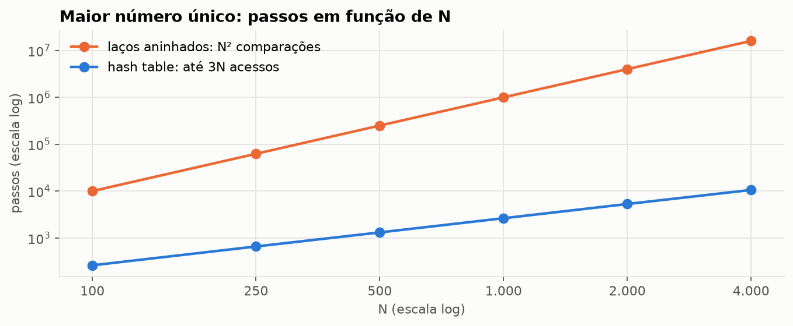
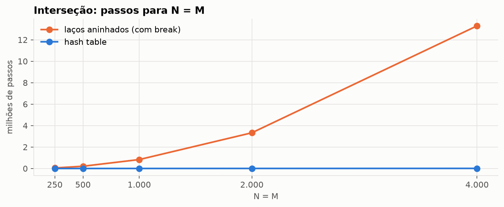
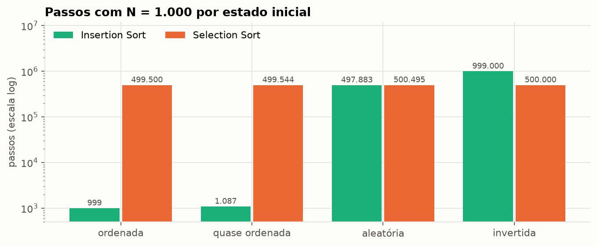
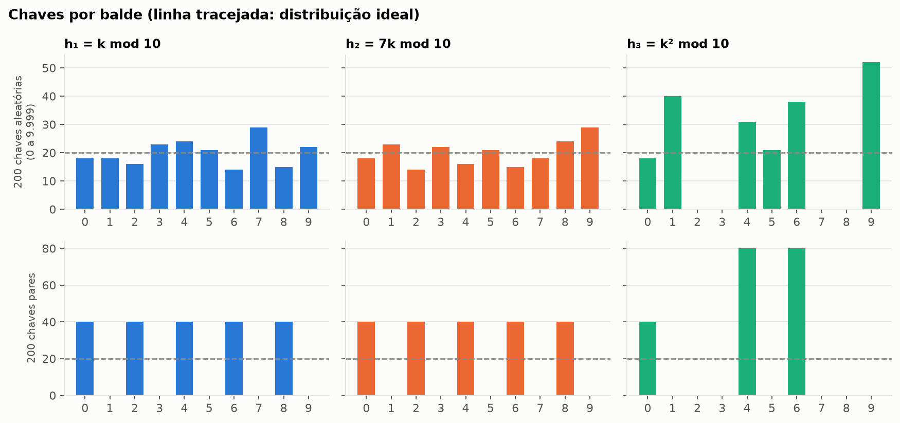
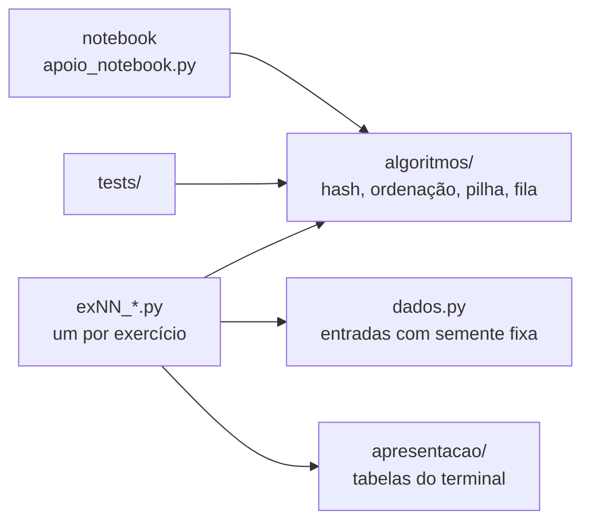

<div align="center">


# #️⃣ Hash Tables, Pilhas e Filas

**Da solução correta à solução eficiente: laços aninhados trocados por hash tables, Selection e Insertion Sort instrumentados, pilha e fila de capacidade fixa e a qualidade de funções hash, com Big O medido em cada passo**

<sub>DR1-TP2 · Bloco Ciência da Computação · Trabalho individual</sub>

<br/>

[](andre_becker_DR1_TP2.ipynb)
[](https://nbviewer.org/github/andrebecker84/dr1-tp2-estruturas-de-dados/blob/main/andre_becker_DR1_TP2.ipynb)
[](docs/RELATORIO_TP2.md)

<br/>

[](#stack)
[-E95420?style=flat-square&logo=ubuntu&logoColor=white)](#stack)
[](#stack)
[](#testes)
[%20%C2%B7%20O(N)%20%C2%B7%20O(N%C2%B2)-6250D6?style=flat-square)](#exercicios)
[](LICENSE)
[](#estado)

<br/>



<sub>Maior número único: N² comparações com laços aninhados contra até 3N acessos com hash table (Exercício 1).</sub>

</div>

---

<a id="indice"></a>

## 📚 Índice

| | O trabalho | | Qualidade e entrega |
|:---:|---|:---:|---|
| 01 | [Visão geral](#visao-geral) | 07 | [Testes automatizados](#testes) |
| 02 | [Os 12 exercícios](#exercicios) | 08 | [Atendimento à rubrica](#atendimento) |
| 03 | [Gráficos](#graficos) | 09 | [Estrutura do projeto](#estrutura) |
| 04 | [Arquitetura](#arquitetura) | 10 | [Estado do projeto](#estado) |
| 05 | [Stack](#stack) | 11 | [Referências](#referencias) |
| 06 | [Como executar](#como-executar) | 12 | [Licença](#licenca) |

---

<a id="visao-geral"></a>

## 💡 Visão geral

Teste de Performance com 12 exercícios sobre eficiência e estruturas de dados. Como no TP1, meço o
custo **contando passos** (comparações, trocas, deslocamentos e acessos às estruturas), não tempo, e
uso a notação Big O para explicar como ele cresce.

| Tema | Ex. | O que o trabalho mostra |
|:---:|:---:|---|
|  | 1 a 5 | laços aninhados trocados por hash tables e presença marcada num array de 26 posições |
|  | 6 e 7 | Selection e Insertion Sort em listas ordenadas, quase ordenadas, aleatórias e invertidas |
|  | 8 a 11 | a escolha entre pilha e fila, as duas com capacidade fixa e erros tratados, e a inversão de string |
|  | 12 | por que h₃ = k² mod 10 desperdiça 40% da tabela e h₂ não melhora h₁ |

As telas são da execução real no meu terminal, o **WezTerm** com o Ubuntu do WSL2 e o shell fish,
capturadas direto da janela. Cada script confere o próprio resultado com `[OK]` ou `[FALHA]`.

> **Bloco:** Ciência da Computação  
> **Disciplina:** Velocidade e Qualidade com Estruturas de Dados e Algoritmos  
> **Trimestre:** 26E4  
> **Professor:** Ian Monteiro Nunes  
> **Aluno:** André Luis Becker  
> **Sala:** GRLENGR2C2-N2-L1  
> **Modalidade:** Individual

> [!IMPORTANT]
> **Decisões declaradas**
> - Uso o `dict` do Python, que é uma hash table, sem `set` nem funções prontas de interseção ou
>   contagem; os acessos ao dicionário são contados um a um.
> - Na interseção (Ex. 2), cada valor comum aparece uma vez, na ordem do segundo array.
> - Na letra ausente (Ex. 4), letras acentuadas contam como a letra base (`ç` → `c`), e a função
>   devolve todas as letras ausentes, não só a primeira.
> - Hash tables, pilhas e filas não estão nos slides das Aulas 1 a 5. A teoria desses exercícios cita o
>   livro indicado no enunciado (Wengrow, caps. 8 e 9) e os clássicos (Cormen, Knuth, Goodrich).

<p align="right"><a href="#indice">⬆ voltar ao índice</a></p>

---

<a id="exercicios"></a>

## 🧭 Os 12 exercícios

#### #️⃣ Hash tables · Ex. 1 a 5

| Ex. | Problema | Estrutura | Resultado principal | Big O | Notebook |
|:---:|---|---|---|---|:---:|
| 1 | Maior número único | hash table | 25.000.000 → 13.148 passos (N = 5.000) | O(N²) → O(N) | [ver](https://nbviewer.org/github/andrebecker84/dr1-tp2-estruturas-de-dados/blob/main/andre_becker_DR1_TP2.ipynb#ex01) |
| 2 | Interseção de arrays | hash table | 2 × 1.000.000 elementos em 2,3 milhões de acessos | O(N·M) → O(N + M) | [ver](https://nbviewer.org/github/andrebecker84/dr1-tp2-estruturas-de-dados/blob/main/andre_becker_DR1_TP2.ipynb#ex02) |
| 3 | Primeiro valor duplicado | hash table | 2N − 1 acessos no pior caso | O(N) | [ver](https://nbviewer.org/github/andrebecker84/dr1-tp2-estruturas-de-dados/blob/main/andre_becker_DR1_TP2.ipynb#ex03) |
| 4 | Letra ausente | array de presença | acentos, dígitos e pontuação tratados | O(N), espaço O(1) | [ver](https://nbviewer.org/github/andrebecker84/dr1-tp2-estruturas-de-dados/blob/main/andre_becker_DR1_TP2.ipynb#ex04) |
| 5 | Primeiro não repetido | hash table | 3N acessos no pior caso | O(N) | [ver](https://nbviewer.org/github/andrebecker84/dr1-tp2-estruturas-de-dados/blob/main/andre_becker_DR1_TP2.ipynb#ex05) |

#### 🔃 Ordenação · Ex. 6 e 7

| Ex. | Problema | Estrutura | Resultado principal | Big O | Notebook |
|:---:|---|---|---|---|:---:|
| 6 | Selection Sort | array | N(N−1)/2 comparações em qualquer estado | Θ(N²) | [ver](https://nbviewer.org/github/andrebecker84/dr1-tp2-estruturas-de-dados/blob/main/andre_becker_DR1_TP2.ipynb#ex06) |
| 7 | Insertion Sort | array | 999 passos (ordenada) × 999.000 (invertida) | O(N) a O(N²) | [ver](https://nbviewer.org/github/andrebecker84/dr1-tp2-estruturas-de-dados/blob/main/andre_becker_DR1_TP2.ipynb#ex07) |

#### 🗂️ Pilha e fila · Ex. 8 a 11

| Ex. | Problema | Estrutura | Resultado principal | Big O | Notebook |
|:---:|---|---|---|---|:---:|
| 8 | Pilha ou fila | **fila** | a 1ª solicitação espera 2 instantes na fila e 9 na pilha | O(1) | [ver](https://nbviewer.org/github/andrebecker84/dr1-tp2-estruturas-de-dados/blob/main/andre_becker_DR1_TP2.ipynb#ex08) |
| 9 | Pilha com controle de erros | array + topo | overflow e underflow sem corromper o estado | O(1) | [ver](https://nbviewer.org/github/andrebecker84/dr1-tp2-estruturas-de-dados/blob/main/andre_becker_DR1_TP2.ipynb#ex09) |
| 10 | Fila com ponteiros | array circular | 100.000 operações sem violar o FIFO | O(1) | [ver](https://nbviewer.org/github/andrebecker84/dr1-tp2-estruturas-de-dados/blob/main/andre_becker_DR1_TP2.ipynb#ex10) |
| 11 | Inversão de string | pilha | N push + N pop, sem slicing | O(N) | [ver](https://nbviewer.org/github/andrebecker84/dr1-tp2-estruturas-de-dados/blob/main/andre_becker_DR1_TP2.ipynb#ex11) |

#### 🧮 Funções hash · Ex. 12

| Ex. | Problema | Tabela | Resultado principal | Notebook |
|:---:|---|---|---|:---:|
| 12 | h₁ = k mod 10, h₂ = 7k mod 10 e h₃ = k² mod 10 | M = 10 | h₃ só alcança 6 dos 10 baldes; h₂ distribui igual a h₁ | [ver](https://nbviewer.org/github/andrebecker84/dr1-tp2-estruturas-de-dados/blob/main/andre_becker_DR1_TP2.ipynb#ex12) |

O [notebook](andre_becker_DR1_TP2.ipynb) segue o mesmo roteiro em todos os exercícios: selos e
indicadores, 📐 fundamentação, 🧩 implementação, 🖥️ execução no terminal e 📊 análise. O
[relatório](docs/RELATORIO_TP2.md) reúne as telas com o trecho de código e o resultado, e é a base do
PDF de entrega. O texto completo do [enunciado](docs/context/enunciado-DR1-TP2.md) e da
[rubrica](docs/context/rubrica-DR1-TP2.md) está em `docs/context/`.

<p align="right"><a href="#indice">⬆ voltar ao índice</a></p>

---

<a id="graficos"></a>

## 📈 Gráficos

<table>
<tr>
<td width="50%"><br/><sub><b>Ex. 2</b> · interseção: parábola do aninhado contra a reta da hash table</sub></td>
<td width="50%"><br/><sub><b>Ex. 7</b> · Insertion x Selection: a entrada decide o vencedor</sub></td>
</tr>
<tr>
<td colspan="2"><br/><sub><b>Ex. 12</b> · h₂ só reordena os baldes de h₁; h₃ deixa quatro baldes sempre vazios</sub></td>
</tr>
</table>

<p align="right"><a href="#indice">⬆ voltar ao índice</a></p>

---

<a id="arquitetura"></a>

## 🏗️ Arquitetura



| Camada | Pasta | Papel |
|---|---|---|
| Modelo | `src/algoritmos/` | Algoritmos e estruturas puros: recebem dados, devolvem resultado, sem `print` |
| Visão | `src/apresentacao/`, `src/apoio_notebook.py` | Tabelas e `[OK]`/`[FALHA]` no terminal; cartões, figuras e gráficos no notebook |
| Controle | `src/exNN_*.py` | Monta os dados do exercício, chama o núcleo e manda para a visão |
| Testes | `src/tests/` | 29 testes do núcleo |

### 🧩 Princípios aplicados

- **Responsabilidade única:** algoritmo, contagem (`Metricas`), dados, verificação e saída ficam em
  módulos separados.
- **Encapsulamento de estado:** `Stack` e `Queue` guardam o array, os índices e o tamanho no próprio
  objeto, e o estado só muda pelos métodos, como pede a nota sobre OO do enunciado.
- **DRY:** a `Stack` do Exercício 9 é a mesma usada na inversão de string do Exercício 11, e a
  simulação do Exercício 8 usa a `Queue` do Exercício 10.
- **Observer:** os callbacks `ao_fim_da_travessia` e `ao_operar` mostram o passo a passo sem `print`
  dentro do algoritmo.
- **YAGNI:** sem interfaces formais nem dependências externas; o notebook é a única parte que usa
  `matplotlib`.

<p align="right"><a href="#indice">⬆ voltar ao índice</a></p>

---

<a id="stack"></a>

## 🛠️ Stack

| Item | Uso |
|---|---|
| **Python 3.15.2** | Versão do projeto, fixada no `.python-version` com o `uv`. Usada no Windows 11 e no Ubuntu 24.04 (WSL2), onde rodaram os prints. O código funciona a partir do Python 3.11 (`enum.StrEnum`). |
| **Biblioteca padrão** | `random`, `unicodedata`, `dataclasses`, `enum`, `time`, `unittest`. Os exercícios não têm dependência externa. |
| **WezTerm + fish** | Terminal das evidências, com o Ubuntu do WSL2; as telas são capturadas da janela por `scripts/capturar_wezterm.py`. |
| **Jupyter + matplotlib** | Só no notebook. Ele é executado no Python 3.12, porque o `matplotlib` ainda não tem pacote para o 3.15. |

<p align="right"><a href="#indice">⬆ voltar ao índice</a></p>

---

<a id="como-executar"></a>

## ▶️ Como executar

### Pré-requisitos

- Python 3.11 ou superior. Nada para instalar além dele.
- O projeto fixa o **3.15.2** no `.python-version`. Com o [uv](https://docs.astral.sh/uv/), ele é
  instalado com `uv python install 3.15.2`.

### Exercícios

Cada exercício é um script independente, executado de dentro de `src/`:

```bash
cd src
python ex01_maior_unico.py
python ex12_funcoes_hash.py
```

### Menu de demonstração

O `demo.py` reúne tudo num menu: cada opção mostra o comando, roda o exercício com um progresso em
braile e exibe a saída.

```bash
cd src
python demo.py
```

### Notebook

Abra o [`andre_becker_DR1_TP2.ipynb`](andre_becker_DR1_TP2.ipynb) aqui no GitHub ou, com o visual
completo, no [nbviewer](https://nbviewer.org/github/andrebecker84/dr1-tp2-estruturas-de-dados/blob/main/andre_becker_DR1_TP2.ipynb).
Para executar de novo, os gráficos precisam do `matplotlib`.

> [!TIP]
> No Linux e no WSL, use `python3` no lugar de `python`. Os resultados são os mesmos em qualquer
> sistema, por causa da semente fixa.

<p align="right"><a href="#indice">⬆ voltar ao índice</a></p>

---

<a id="testes"></a>

## ✅ Testes automatizados

| Arquivo | Testes | O que confere |
|---|:---:|---|
| `src/tests/test_algoritmos.py` | 19 | hash × aninhado com o mesmo resultado em 100 listas aleatórias; contadores (N², ≤ 3N, 2N − 1, 3N); interseção sem repetidos; letras ausentes com acentos; Selection e Insertion (resultado, entrada intacta, N(N−1)/2, exemplo dos slides, melhor e pior caso, deslocamentos = inversões); funções hash |
| `src/tests/test_estruturas.py` | 10 | LIFO, FIFO com volta no array, overflow e underflow sem alterar o estado, capacidade inválida, 5.000 operações aleatórias na fila, inversão com a sequência exata de push e pop |

```bash
cd src
python -m unittest discover -s tests -t . -v
```

<p align="right"><a href="#indice">⬆ voltar ao índice</a></p>

---

<a id="atendimento"></a>

## 🎯 Atendimento à rubrica

| Critério | Onde está |
|---|---|
| Identificou gargalos em implementações iniciais | Laço interno completo (Ex. 1), N × M comparações (Ex. 2), comparação com todos os anteriores (Ex. 3) |
| Reduziu a complexidade, justificando a melhoria | Ex. 1, 2, 3 e 5: O(N²) → O(N), com o mesmo resultado nas duas versões |
| Implementou Selection Sort e Insertion Sort | Ex. 6 e 7, com o passo a passo dos slides e testes |
| Mensurou a complexidade com Big O | Contadores em todos os algoritmos, conferidos contra N², 3N, 2N − 1 e N(N−1)/2 |
| Comparou algoritmos em diferentes cenários | Quatro estados iniciais nos Ex. 6 e 7; tamanhos de 10 a 1.000.000 nos Ex. 1 a 5 |
| Usou hash tables para recuperação eficiente | Ex. 1, 2, 3 e 5 (`dict`) e Ex. 4 (endereçamento direto) |
| Escolheu entre pilha e fila conforme o problema | Ex. 8: fila, com simulação contra a pilha |
| Pilha com overflow e underflow explícitos | Ex. 9: exceções `Overflow` e `Underflow`, estado preservado |
| Fila com comportamento FIFO | Ex. 10: ponteiros circulares e 100.000 operações validadas |
| Aplicou pilhas a problemas concretos | Ex. 11: inversão de string com push e pop explícitos |
| Notebook claro e estruturado | Sumário, uma seção por exercício: indicadores, fundamentação, código, tela, gráfico e leitura |
| Decisões técnicas documentadas | Blocos "Decisões" no notebook e a seção [Visão geral](#visao-geral) |
| Evidências completas de execução | 13 telas do WezTerm, saídas em texto em `evidencias/saidas/` e PDF de entrega |
| Consistência entre código, resultados e teoria | O notebook chama as mesmas funções que rodaram no terminal; os números coincidem com as telas |

<p align="right"><a href="#indice">⬆ voltar ao índice</a></p>

---

<a id="estrutura"></a>

## 📁 Estrutura do projeto

```
DR1_TP2/
├── andre_becker_DR1_TP2.ipynb   notebook com a análise completa
├── LICENSE                      licença de código visível, com o aviso LGPD
├── src/
│   ├── algoritmos/              hash, ordenação, pilha, fila, funções hash e métricas (sem entrada e saída)
│   ├── apresentacao/            tabelas do terminal
│   ├── tests/                   29 testes
│   ├── apoio_notebook.py        cartões, tabelas, figuras e gráficos do notebook
│   ├── dados.py                 entradas dos experimentos
│   ├── verificacao.py           conferências (ordenação, inversões, inversão de string)
│   ├── demo.py                  menu de demonstração
│   └── ex01 ... ex12            um script por exercício
├── docs/
│   ├── RELATORIO_TP2.md         telas, trechos de código e resultados (base do PDF)
│   ├── context/                 enunciado e rubrica
│   └── molde/                   modelo do documento de entrega
├── evidencias/
│   ├── telas/                   prints do WezTerm
│   ├── graficos/                gráficos do notebook
│   └── saidas/                  texto de cada tela
└── scripts/                     captura das telas, notebook e documento de entrega
```

<p align="right"><a href="#indice">⬆ voltar ao índice</a></p>

---

<a id="estado"></a>

## 📌 Estado do projeto

Entrega concluída. Os 12 exercícios estão implementados, executados e documentados, e os 29 testes
passam. O documento de entrega (`andre_becker_DR1_TP2.pdf`, com as telas) vai pela plataforma do
Infnet e não é versionado aqui.

<p align="right"><a href="#indice">⬆ voltar ao índice</a></p>

---

<a id="referencias"></a>

## 📖 Referências

- WENGROW, J. *A Common-Sense Guide to Data Structures and Algorithms in Python*, vol. 1. Pragmatic Bookshelf, 2023. Caps. 4 a 9.
- NUNES, I. M. Slides das Aulas 4 e 5 da disciplina. Instituto Infnet, 2026.
- CORMEN, T. H. et al. *Algoritmos: teoria e prática*. 3. ed. Elsevier, 2012. Cap. 11.
- KNUTH, D. E. *The Art of Computer Programming*, vol. 3. 2. ed. Addison-Wesley, 1998. Seção 6.4.
- GOODRICH, M.; TAMASSIA, R.; GOLDWASSER, M. *Data Structures and Algorithms in Python*. Wiley, 2013. Cap. 6.

<p align="right"><a href="#indice">⬆ voltar ao índice</a></p>

---

<a id="licenca"></a>

## 📜 Licença

Copyright © 2026 André Luis Becker. Todos os direitos reservados, sobre a contribuição original
deste trabalho.

Este repositório é **de código visível (source-available), não de código aberto**. É público para
ser lido, estudado e avaliado, e o corpo docente da instituição avaliadora pode executá-lo
livremente para conferir a entrega. Qualquer outro uso, incluindo clonar, executar, modificar ou
redistribuir, depende de autorização escrita.

O enunciado, a rubrica e as definições fornecidas pelo professor não são alcançados por esta
licença e seguem os termos de seus autores.

Os termos completos, com o anexo de proteção de dados (LGPD), estão na [LICENSE](LICENSE). Pedidos
de autorização são gratuitos: abra uma [issue](https://github.com/andrebecker84/dr1-tp2-estruturas-de-dados/issues).

<p align="right"><a href="#indice">⬆ voltar ao índice</a></p>
