<div align="center">


# 📑 Hash Tables, Pilhas e Filas em Python

**Evidências de execução dos 12 exercícios: o trecho principal do código, a tela do terminal e o resultado**

[](https://nbviewer.org/github/andrebecker84/dr1-tp2-estruturas-de-dados/blob/main/andre_becker_DR1_TP2.ipynb)
[](context/enunciado-DR1-TP2.md)
[](context/rubrica-DR1-TP2.md)
[](../README.md)

</div>

| | |
|---|---|
| **Bloco** | Ciência da Computação · DR1-TP2 |
| **Disciplina** | Velocidade e Qualidade com Estruturas de Dados e Algoritmos |
| **Trimestre** | 26E4 |
| **Professor** | Ian Monteiro Nunes |
| **Aluno** | André Luis Becker |
| **Sala** | GRLENGR2C2-N2-L1 |
| **Repositório** | [andrebecker84/dr1-tp2-estruturas-de-dados](https://github.com/andrebecker84/dr1-tp2-estruturas-de-dados) |

<!--
Fonte do documento de entrega (scripts/gerar_documento.py). Os blocos "codigo" são preenchidos por
scripts/tp2_fonte.py a partir de src/; o que fica entre "so-github" e as âncoras <a id> aparece só aqui.
A análise completa, com a teoria e os gráficos, está no notebook andre_becker_DR1_TP2.ipynb.
-->

<!-- so-github -->
<a id="sumario"></a>

## 📚 Sumário

| | Seção | | Seção |
|:-:|---|:-:|---|
| | [Apresentação](#apresentacao) | 7 | [Insertion Sort](#exercicio-7) |
| 1 | [Maior número único com hash table](#exercicio-1) | 8 | [Pilha ou fila](#exercicio-8) |
| 2 | [Interseção de arrays em tempo linear](#exercicio-2) | 9 | [Pilha com controle de erros](#exercicio-9) |
| 3 | [Primeiro valor duplicado](#exercicio-3) | 10 | [Fila com ponteiros](#exercicio-10) |
| 4 | [Letra ausente do alfabeto](#exercicio-4) | 11 | [Inversão de string com pilha](#exercicio-11) |
| 5 | [Primeiro caractere não repetido](#exercicio-5) | 12 | [Funções hash e distribuição](#exercicio-12) |
| 6 | [Selection Sort](#exercicio-6) | | [Testes automatizados](#testes) · [Referências](#referencias) |

---
<!-- /so-github -->

<a id="apresentacao"></a>

## Apresentação

Implementei os 12 exercícios em Python 3.15.2, só com a biblioteca padrão. Os prints são do meu
terminal, o WezTerm com o Ubuntu 24.04 do WSL2 e o shell fish, e foram capturados direto da janela,
sem edição. Como no TP1, meço eficiência contando passos (comparações, trocas, deslocamentos e
acessos às estruturas). Cada script confere o próprio resultado com `[OK]` ou `[FALHA]`.

| Ex. | Problema | Estrutura | Resultado | Big O |
|---|---|---|---|---|
| 1 | Maior número único | hash table | 25.000.000 → 13.148 passos (N = 5.000) | O(N²) → O(N) |
| 2 | Interseção de arrays | hash table | 2 × 1.000.000 elementos validados | O(N + M) |
| 3 | Primeiro duplicado | hash table | 2N − 1 acessos no pior caso | O(N) |
| 4 | Letra ausente | array de 26 posições | acentos, dígitos e pontuação tratados | O(N), espaço O(1) |
| 5 | Primeiro não repetido | hash table | 3N acessos no pior caso | O(N) |
| 6 | Selection Sort | array | N(N−1)/2 comparações em qualquer estado | O(N²) |
| 7 | Insertion Sort | array | 999 passos (ordenada) × 999.000 (invertida) | O(N) a O(N²) |
| 8 | Ordem de chegada | fila | a fila respeita a ordem; a pilha não | O(1) |
| 9 | Pilha de capacidade fixa | array + topo | overflow e underflow tratados | O(1) |
| 10 | Fila com ponteiros | array circular | 100.000 operações sem violar o FIFO | O(1) |
| 11 | Inversão de string | pilha | N push + N pop, sem slicing | O(N) |
| 12 | Funções hash (M = 10) | | h₃ só alcança 6 dos 10 baldes | |

Os 29 testes de `src/tests/` passam (Figura 13). O notebook, com a teoria, os gráficos e as
justificativas de cada exercício, e o código estão no repositório:

[Repositório no GitHub: andrebecker84/dr1-tp2-estruturas-de-dados](https://github.com/andrebecker84/dr1-tp2-estruturas-de-dados)

[Notebook no nbviewer: andre_becker_DR1_TP2.ipynb](https://nbviewer.org/github/andrebecker84/dr1-tp2-estruturas-de-dados/blob/main/andre_becker_DR1_TP2.ipynb)

<a id="exercicio-1"></a>

## Exercício 1: Maior número único com hash table

<!-- so-github -->
 
<!-- /so-github -->

<!-- codigo: algoritmos/unicos.py maior_unico_aninhado,maior_unico_hash -->
```python
def maior_unico_aninhado(arr, metricas=None):
    metricas = metricas or Metricas()
    maior = None
    for i in range(len(arr)):
        contador = 0
        for j in range(len(arr)):           # gargalo: N voltas para cada um dos N elementos
            metricas.comparacoes += 1
            if arr[j] == arr[i]:
                contador += 1
        if contador == 1 and (maior is None or arr[i] > maior):
            maior = arr[i]
    return maior

def maior_unico_hash(arr, metricas=None):
    metricas = metricas or Metricas()
    ocorrencias = {}
    for valor in arr:
        metricas.acessos += 2               # uma leitura (get) e uma escrita
        ocorrencias[valor] = ocorrencias.get(valor, 0) + 1

    maior = None
    for valor, quantidade in ocorrencias.items():
        metricas.acessos += 1               # leitura de um par valor -> quantidade
        if quantidade == 1 and (maior is None or valor > maior):
            maior = valor
    return maior
```
<!-- /codigo -->

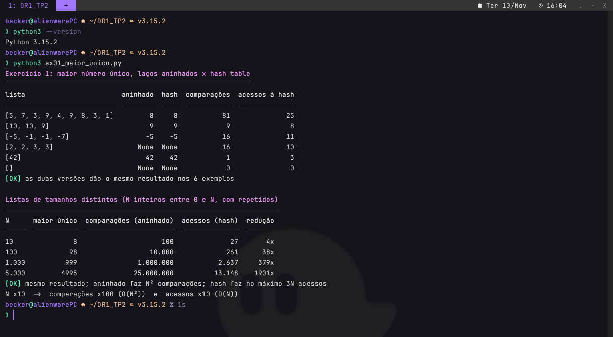

O gargalo da versão aninhada é o laço interno, que percorre a lista inteira para cada elemento: são
**N² comparações** em qualquer entrada. Com a hash table, as duas passadas são sequenciais, e o custo cai
para no máximo **3N acessos**, ou seja, **O(N)**. Com N = 5.000, foram 25.000.000 comparações contra
13.148 acessos.

<!-- so-github -->
<p align="right"><a href="#sumario">⬆ voltar ao sumário</a></p>
<!-- /so-github -->

<a id="exercicio-2"></a>

## Exercício 2: Interseção de arrays em tempo linear

<!-- so-github -->
 
<!-- /so-github -->

<!-- codigo: algoritmos/intersecao.py intersecao -->
```python
def intersecao(a, b, metricas=None):
    metricas = metricas or Metricas()
    tabela = {}
    for valor in a:
        metricas.acessos += 1
        tabela[valor] = True                # True: está em a e ainda não entrou no resultado

    comuns = []
    for valor in b:
        metricas.acessos += 1
        if tabela.get(valor):
            comuns.append(valor)
            metricas.acessos += 1
            tabela[valor] = False           # um repetido em b não entra de novo
    return comuns
```
<!-- /codigo -->

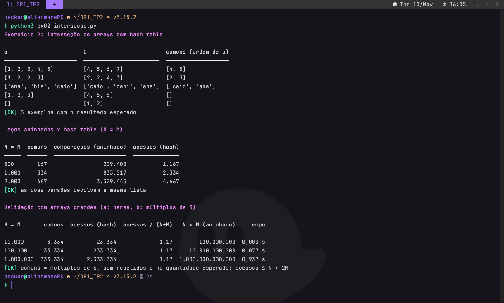

O primeiro array vai para um `dict` e cada valor do segundo é consultado em O(1), sem `set` nem
funções de interseção. O total é de até **N + 2M acessos: O(N + M)**. Na validação, a resposta é
conhecida por construção (pares ∩ múltiplos de 3 = múltiplos de 6). Com 1.000.000 de elementos em
cada array, a função fez 1,17 acesso por elemento e levou 0,94 s; a versão aninhada chegaria a 10¹²
comparações.

<!-- so-github -->
<p align="right"><a href="#sumario">⬆ voltar ao sumário</a></p>
<!-- /so-github -->

<a id="exercicio-3"></a>

## Exercício 3: Primeiro valor duplicado

<!-- so-github -->
 
<!-- /so-github -->

<!-- codigo: algoritmos/duplicados.py primeiro_duplicado -->
```python
def primeiro_duplicado(valores, metricas=None):
    metricas = metricas or Metricas()
    vistos = {}
    for valor in valores:
        metricas.acessos += 1
        if valor in vistos:
            return valor
        metricas.acessos += 1
        vistos[valor] = True
    return None
```
<!-- /codigo -->

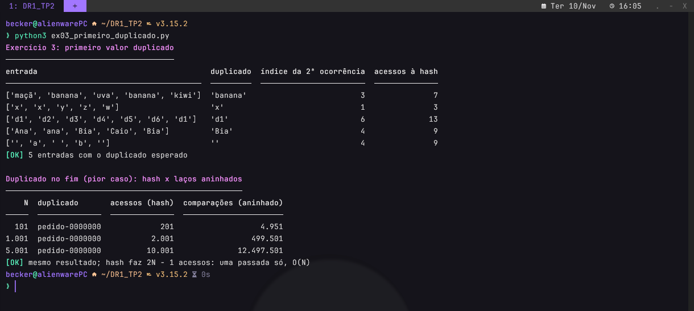

Uma passada na ordem de leitura, consultando a hash table dos valores já vistos, e a função para na
primeira repetição. O pior caso, com o par nas pontas, custa **2N − 1 acessos: O(N)**. A versão aninhada
precisou de 12.497.501 comparações onde a hash table fez 10.001 acessos.

<!-- so-github -->
<p align="right"><a href="#sumario">⬆ voltar ao sumário</a></p>
<!-- /so-github -->

<a id="exercicio-4"></a>

## Exercício 4: Letra ausente do alfabeto

<!-- so-github -->
 
<!-- /so-github -->

<!-- codigo: algoritmos/texto.py sem_acento,letras_ausentes -->
```python
def sem_acento(texto):
    decomposto = unicodedata.normalize("NFD", texto.casefold())
    return "".join(c for c in decomposto if unicodedata.category(c) != "Mn")

def letras_ausentes(texto, metricas=None):
    metricas = metricas or Metricas()
    presente = [False] * LETRAS              # uma posição por letra: a -> 0, ..., z -> 25
    for caractere in texto:
        for letra in sem_acento(caractere):  # 'Ç' -> 'c'; um caractere só, sem copiar o texto inteiro
            if "a" <= letra <= "z":         # espaços, dígitos e pontuação ficam de fora
                metricas.acessos += 1
                presente[ord(letra) - ord("a")] = True

    ausentes = []
    for posicao in range(LETRAS):
        metricas.acessos += 1
        if not presente[posicao]:
            ausentes.append(chr(ord("a") + posicao))
    return ausentes
```
<!-- /codigo -->

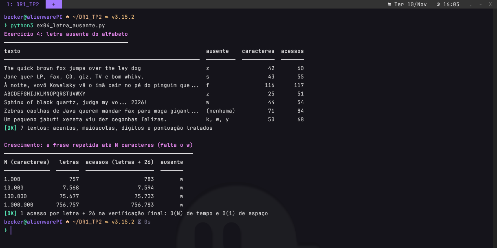

Cada caractere passa por `casefold` e pela remoção do acento (`ç` → `c`); o que fica fora de `a`–`z` é
ignorado. A presença é marcada num array de 26 posições indexado por `ord(letra) − ord('a')`.
O tempo é **O(N)** (uma leitura por caractere e mais 26 verificações) e o espaço é **O(1)**, porque são
sempre 26 posições.

<!-- so-github -->
<p align="right"><a href="#sumario">⬆ voltar ao sumário</a></p>
<!-- /so-github -->

<a id="exercicio-5"></a>

## Exercício 5: Primeiro caractere não repetido

<!-- so-github -->
 
<!-- /so-github -->

<!-- codigo: algoritmos/texto.py primeiro_nao_repetido -->
```python
def primeiro_nao_repetido(texto, metricas=None):
    metricas = metricas or Metricas()
    frequencia = {}
    for caractere in texto:                 # 1ª passada: contagem
        metricas.acessos += 2
        frequencia[caractere] = frequencia.get(caractere, 0) + 1

    for caractere in texto:                 # 2ª passada: verificação na ordem original
        metricas.acessos += 1
        if frequencia[caractere] == 1:
            return caractere
    return None
```
<!-- /codigo -->

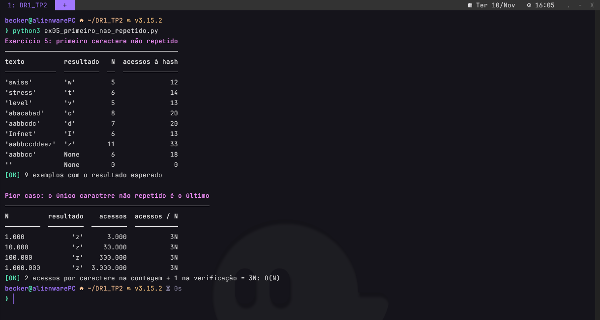

A primeira passada conta as frequências na hash table. A segunda percorre o **texto**, não o dicionário,
e por isso preserva a ordem original. O pior caso custa exatamente **3N acessos: O(N)**.

<!-- so-github -->
<p align="right"><a href="#sumario">⬆ voltar ao sumário</a></p>
<!-- /so-github -->

<a id="exercicio-6"></a>

## Exercício 6: Selection Sort

<!-- so-github -->
 
<!-- /so-github -->

<!-- codigo: algoritmos/ordenacao.py selection_sort -->
```python
def selection_sort(seq, metricas=None, ao_fim_da_travessia=None):
    metricas = metricas or Metricas()
    lista = list(seq)
    for inicio in range(len(lista) - 1):
        menor = inicio
        for i in range(inicio + 1, len(lista)):
            metricas.comparacoes += 1
            if lista[i] < lista[menor]:
                menor = i
        if menor != inicio:                 # com o menor já no lugar, não há troca
            lista[inicio], lista[menor] = lista[menor], lista[inicio]
            metricas.trocas += 1
        if ao_fim_da_travessia:
            ao_fim_da_travessia(lista, metricas)
    return lista
```
<!-- /codigo -->

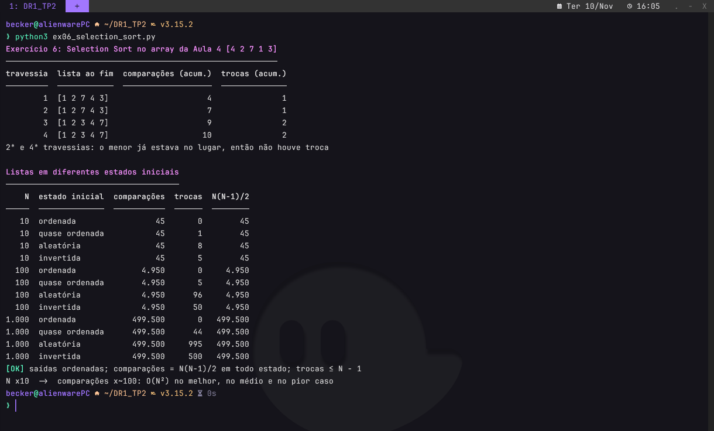

As comparações são **N(N−1)/2 em todos os estados**: 499.500 com N = 1.000, seja a lista ordenada,
quase ordenada, aleatória ou invertida. Só as trocas variam, sempre no máximo N − 1. O custo é **O(N²)**
no melhor, no médio e no pior caso, porque nada encerra uma travessia mais cedo.

<!-- so-github -->
<p align="right"><a href="#sumario">⬆ voltar ao sumário</a></p>
<!-- /so-github -->

<a id="exercicio-7"></a>

## Exercício 7: Insertion Sort

<!-- so-github -->
 
<!-- /so-github -->

<!-- codigo: algoritmos/ordenacao.py insertion_sort -->
```python
def insertion_sort(seq, metricas=None, ao_fim_da_travessia=None):
    metricas = metricas or Metricas()
    lista = list(seq)
    for indice in range(1, len(lista)):
        temp = lista[indice]
        posicao = indice - 1
        while posicao >= 0:
            metricas.comparacoes += 1
            if lista[posicao] <= temp:      # achou um valor menor ou igual: fim dos deslocamentos
                break
            lista[posicao + 1] = lista[posicao]
            metricas.deslocamentos += 1
            posicao -= 1
        lista[posicao + 1] = temp
        if ao_fim_da_travessia:
            ao_fim_da_travessia(lista, metricas)
    return lista
```
<!-- /codigo -->

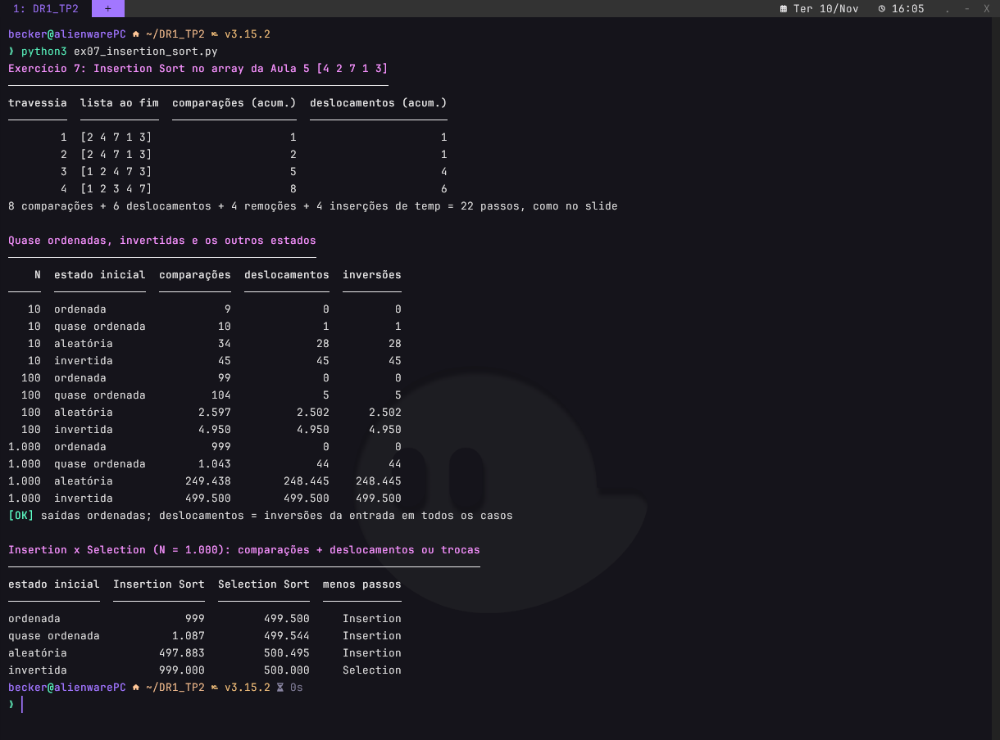

| Caso | Entrada | Comparações | Deslocamentos | Big O |
|---|---|---|---|---|
| Melhor | ordenada | N − 1 | 0 | O(N) |
| Pior | invertida | N(N−1)/2 | N(N−1)/2 | O(N²) |

Os deslocamentos são iguais ao número de inversões da entrada. Por isso a lista quase ordenada
(N = 1.000) custou 1.043 comparações e 44 deslocamentos, e a invertida, 499.500 de cada.

<!-- so-github -->
<p align="right"><a href="#sumario">⬆ voltar ao sumário</a></p>
<!-- /so-github -->

<a id="exercicio-8"></a>

## Exercício 8: Pilha ou fila

<!-- so-github -->
 
<!-- /so-github -->

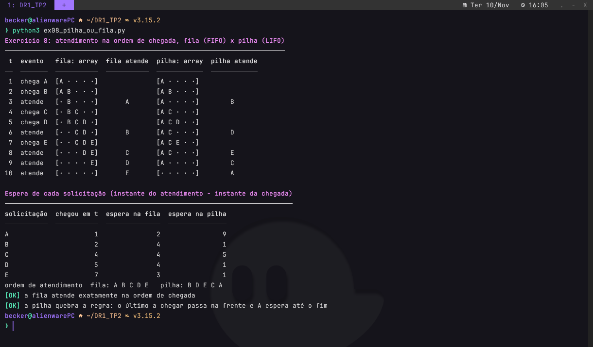

Atender estritamente na ordem de chegada é a regra **FIFO**, então a escolha é a **fila**. As operações
são `enqueue` (registra a chegada no fim), `dequeue` (atende a mais antiga, no início), `peek`,
`is_empty` e `is_full`, todas O(1). Na simulação, a fila atende A B C D E. A pilha (LIFO) atende
B D E C A, e a primeira solicitação espera 9 instantes em vez de 2.

<!-- so-github -->
<p align="right"><a href="#sumario">⬆ voltar ao sumário</a></p>
<!-- /so-github -->

<a id="exercicio-9"></a>

## Exercício 9: Pilha com controle de erros

<!-- so-github -->
 
<!-- /so-github -->

<!-- codigo: algoritmos/pilha.py Stack -->
```python
class Stack:
    def __init__(self, capacidade):
        if not isinstance(capacidade, int) or capacidade < 1:
            raise ValueError("capacidade deve ser um inteiro positivo")
        self._dados = [None] * capacidade
        self._topo = VAZIA

    @property
    def capacidade(self):
        return len(self._dados)

    @property
    def topo(self):
        return self._topo

    def size(self):
        return self._topo + 1

    def is_empty(self):
        return self._topo == VAZIA

    def is_full(self):
        return self._topo == self.capacidade - 1

    def push(self, valor):
        if self.is_full():
            raise Overflow(f"push({valor!r}) recusado: pilha cheia ({self.capacidade}/{self.capacidade})")
        self._topo += 1
        self._dados[self._topo] = valor

    def pop(self):
        if self.is_empty():
            raise Underflow("pop() recusado: pilha vazia")
        valor = self._dados[self._topo]
        self._dados[self._topo] = None      # a posição volta a ficar livre
        self._topo -= 1
        return valor

    def peek(self):
        if self.is_empty():
            raise Underflow("peek() recusado: pilha vazia")
        return self._dados[self._topo]

    def array(self):
        return list(self._dados)
```
<!-- /codigo -->

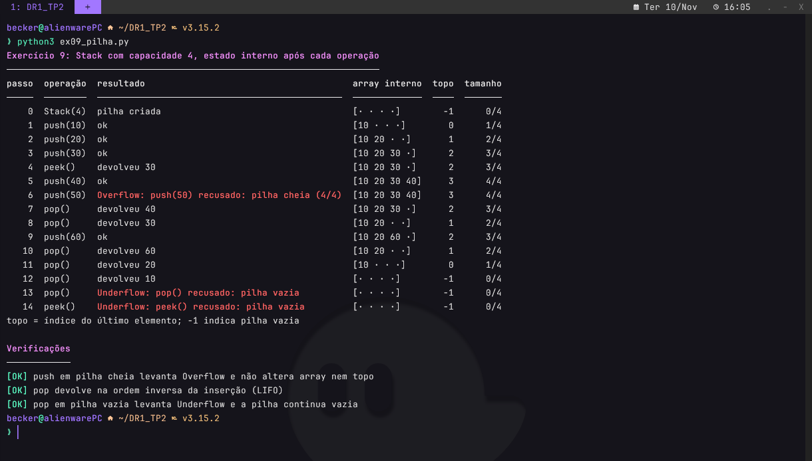

O estado fica no objeto: o array de tamanho fixo e o índice do topo. `push` em pilha cheia levanta
`Overflow` e `pop` ou `peek` em pilha vazia levantam `Underflow`, sempre antes de alterar o estado.
Por isso o array e o topo ficam intactos depois de cada erro.

<!-- so-github -->
<p align="right"><a href="#sumario">⬆ voltar ao sumário</a></p>
<!-- /so-github -->

<a id="exercicio-10"></a>

## Exercício 10: Fila com ponteiros

<!-- so-github -->
 
<!-- /so-github -->

<!-- codigo: algoritmos/fila.py Queue -->
```python
class Queue:
    def __init__(self, capacidade):
        if not isinstance(capacidade, int) or capacidade < 1:
            raise ValueError("capacidade deve ser um inteiro positivo")
        self._dados = [None] * capacidade
        self._inicio = 0
        self._fim = 0
        self._tamanho = 0

    @property
    def capacidade(self):
        return len(self._dados)

    @property
    def inicio(self):
        return self._inicio

    @property
    def fim(self):
        return self._fim

    def size(self):
        return self._tamanho

    def is_empty(self):
        return self._tamanho == 0

    def is_full(self):
        return self._tamanho == self.capacidade

    def enqueue(self, valor):
        if self.is_full():
            raise Overflow(f"enqueue({valor!r}) recusado: fila cheia ({self.capacidade}/{self.capacidade})")
        self._dados[self._fim] = valor
        self._fim = (self._fim + 1) % self.capacidade
        self._tamanho += 1

    def dequeue(self):
        if self.is_empty():
            raise Underflow("dequeue() recusado: fila vazia")
        valor = self._dados[self._inicio]
        self._dados[self._inicio] = None
        self._inicio = (self._inicio + 1) % self.capacidade
        self._tamanho -= 1
        return valor

    def peek(self):
        if self.is_empty():
            raise Underflow("peek() recusado: fila vazia")
        return self._dados[self._inicio]

    def array(self):
        return list(self._dados)
```
<!-- /codigo -->

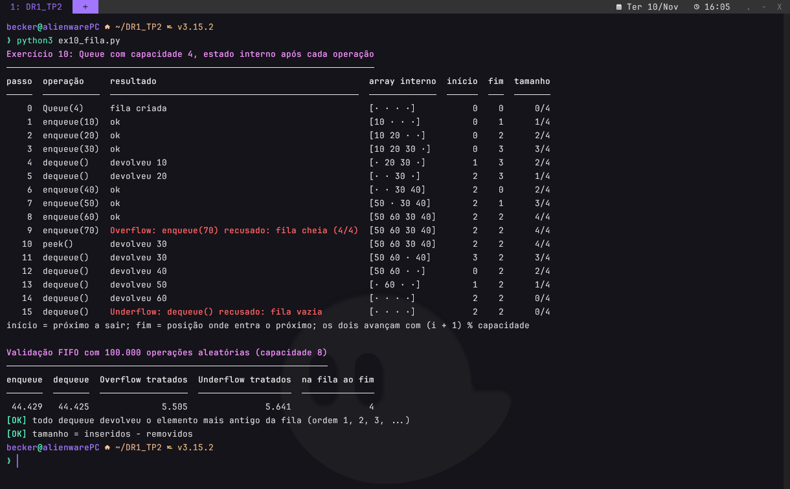

`inicio` aponta o próximo a sair e `fim` a posição onde entra o próximo; os dois avançam com
`(i + 1) % capacidade`, num array circular. Nos passos 6 a 8 o fim dá a volta e reaproveita as posições
liberadas. Em 100.000 operações aleatórias, todo `dequeue` devolveu o elemento mais antigo da fila.

<!-- so-github -->
<p align="right"><a href="#sumario">⬆ voltar ao sumário</a></p>
<!-- /so-github -->

<a id="exercicio-11"></a>

## Exercício 11: Inversão de string com pilha

<!-- so-github -->
 
<!-- /so-github -->

<!-- codigo: algoritmos/texto.py inverter -->
```python
def inverter(texto, ao_operar=None):
    pilha = Stack(max(len(texto), 1))
    for caractere in texto:
        pilha.push(caractere)
        if ao_operar:
            ao_operar("push", caractere, pilha)

    invertido = []
    while not pilha.is_empty():
        caractere = pilha.pop()
        invertido.append(caractere)
        if ao_operar:
            ao_operar("pop", caractere, pilha)
    return "".join(invertido)
```
<!-- /codigo -->

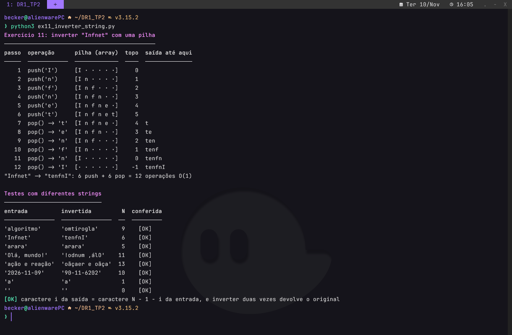

Cada caractere é empilhado na `Stack` do Exercício 9 e desempilhado em seguida, e como a pilha é LIFO
eles saem na ordem inversa. São N push e N pop, **O(N)**, sem slicing nem `reversed()`. A conferência
compara a posição *i* da saída com a posição N − 1 − *i* da entrada.

<!-- so-github -->
<p align="right"><a href="#sumario">⬆ voltar ao sumário</a></p>
<!-- /so-github -->

<a id="exercicio-12"></a>

## Exercício 12: Funções hash e distribuição

<!-- so-github -->
 
<!-- /so-github -->

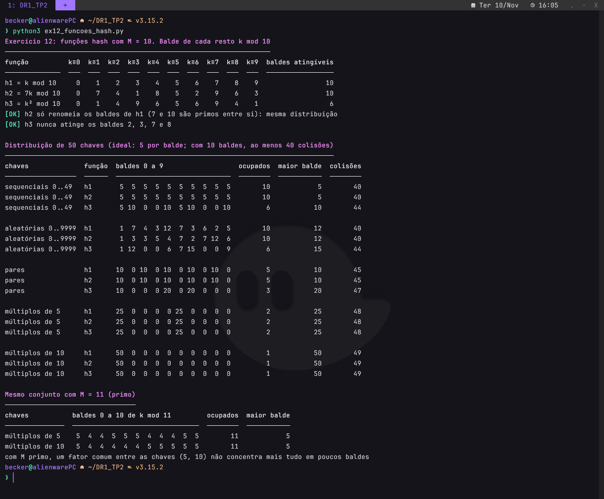

Com M = 10, as três funções dependem só do último dígito da chave (k mod 10):

- **h₃ = k² mod 10 tem o maior risco de colisão:** só alcança os baldes 0, 1, 4, 5, 6 e 9, deixando 40%
  da tabela sempre vazia, e dobra a carga dos baldes 1, 4, 6 e 9 mesmo com chaves uniformes.
- **h₂ = 7k mod 10 equivale a h₁ = k mod 10:** como mdc(7, 10) = 1, a multiplicação só renomeia os baldes,
  e as colisões são as mesmas.
- **h₁ e h₂** vão bem com chaves de último dígito uniforme, mas pares ocupam 5 baldes, múltiplos de 5
  ocupam 2 e múltiplos de 10 ocupam 1.

A causa é M = 10 ser a base decimal; com M primo (11), os mesmos múltiplos ocupam os 11 baldes. A
análise completa, em Markdown, está no notebook.

<!-- so-github -->
<p align="right"><a href="#sumario">⬆ voltar ao sumário</a></p>
<!-- /so-github -->

<a id="testes"></a>

## Testes automatizados

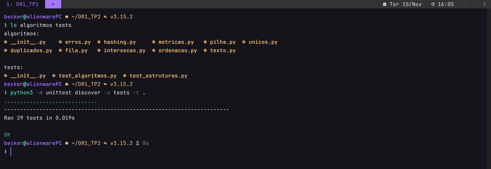

<!-- so-github -->
<p align="right"><a href="#sumario">⬆ voltar ao sumário</a></p>
<!-- /so-github -->

<a id="referencias"></a>

## Referências

- CORMEN, T. H. et al. *Algoritmos: teoria e prática*. 3. ed. Rio de Janeiro: Elsevier, 2012.
- GOODRICH, M. T.; TAMASSIA, R.; GOLDWASSER, M. H. *Data structures and algorithms in Python*. Hoboken: Wiley, 2013.
- KNUTH, D. E. *The art of computer programming*: volume 3: sorting and searching. 2. ed. Reading: Addison-Wesley, 1998.
- NUNES, I. M. Aulas 4 e 5 da disciplina Velocidade e Qualidade com Estruturas de Dados e Algoritmos. Instituto Infnet, 2026. Slides.
- WENGROW, J. *A common-sense guide to data structures and algorithms in Python*: volume 1. Raleigh: The Pragmatic Bookshelf, 2023.

<!-- so-github -->
<p align="right"><a href="#sumario">⬆ voltar ao sumário</a></p>
<!-- /so-github -->
